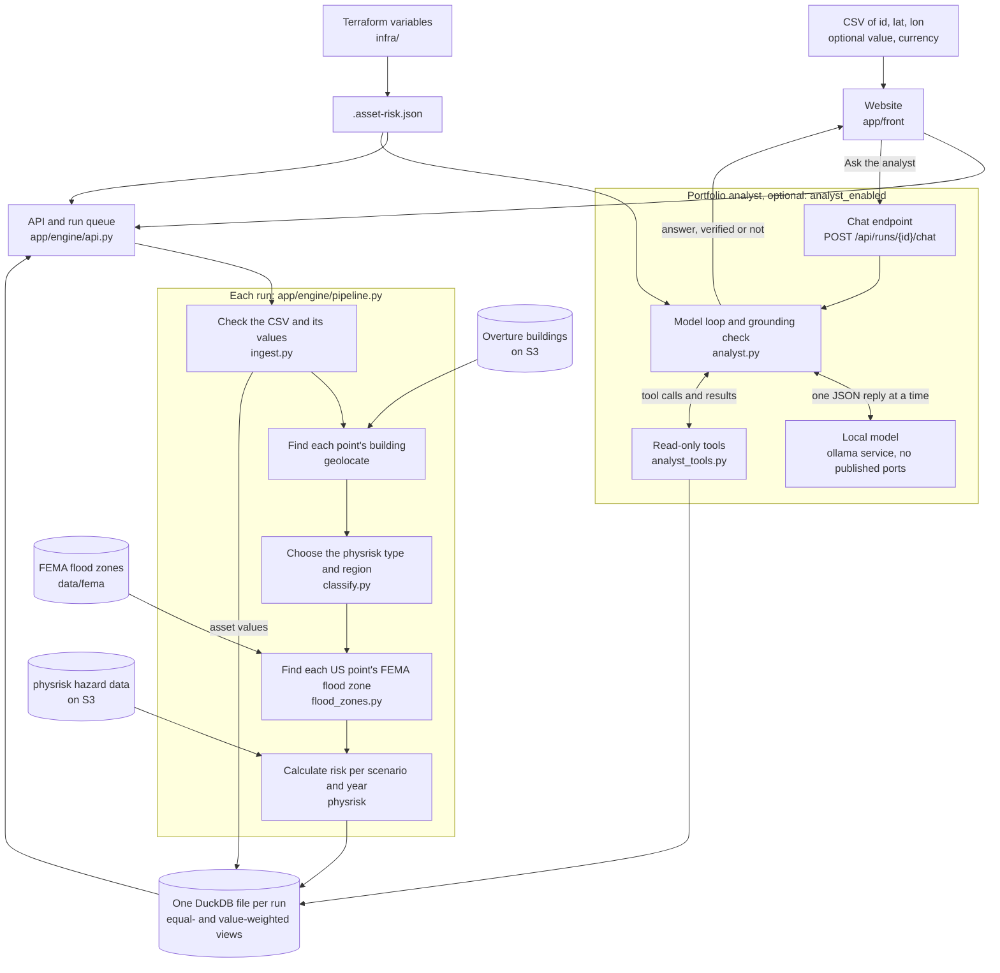
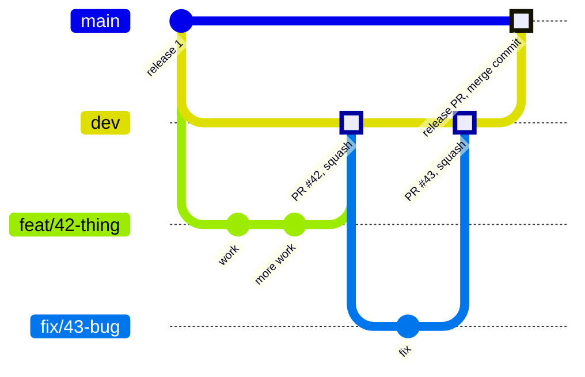

# asset-risk

Upload a CSV of `id, lat, lon` and get a physical climate risk view of the portfolio. Each point is
matched to a building with [geolocate](https://github.com/mnovovil/geolocate), assessed with
[physrisk](https://github.com/os-climate/physrisk), and shown in a web dashboard. Give each asset
a value and the results can also be weighted by it, and an optional analyst running on your own
machine answers questions about a finished portfolio, with every number it quotes checked.

This is a screening tool, not a site-level assessment. Results are a share of asset value, and
[most buildings have no known type](docs/methodology.md#building-type), so read
[the methodology](docs/methodology.md) before relying on a number.

https://github.com/user-attachments/assets/97d704e0-aa61-42ec-8060-1aaca6f5165f

## Quick start

You need Docker, [Terraform](https://developer.hashicorp.com/terraform/install) ≥ 1.3 or OpenTofu,
several GB of free disk for the first build, and internet access.

```bash
git clone --recurse-submodules git@github.com:mnovovil/asset-risk.git && cd asset-risk
terraform -chdir=infra init && terraform -chdir=infra apply   # writes the settings files
script/start.sh                                               # http://127.0.0.1:8000
```

For FEMA flood zones on US assets, build their database once from FEMA's flood hazard data (see
[Data sources](docs/data-sources.md#fema-flood-zones)). Without it, runs work as usual and show the
zones as unavailable.

Open the address to see every portfolio assessed so far, each as a card with its mean annual loss,
its counts and a picture of its risk map. **Delete** removes a finished one. Choose
**New portfolio** and drop in a CSV. The upload page has a sample to download, and your file needs
a header with at least id, lat, lon columns. You can add a `value` column, and a `currency` such as `USD`, for value-weighted results and
expected losses in money:

```csv
id,lat,lon,value,currency
empire-state,40.7484,-73.9857,2300000000,USD
big-ben,51.5007,-0.1246,,
```

A missing or unreadable value never drops an asset: it's still assessed, flagged, and left out of
the weighting. The dashboard then offers **Weighting: By value** beside the default equal weighting.
See [Portfolio CSV](docs/reference.md#portfolio-csv) for the rules and
[the methodology](docs/methodology.md#weighting-by-value) for how to read them.

A finished portfolio's page has two downloads beside its filters: **Download results as CSV**, with
every figure, and **Download report as PDF**, the map, loss bars and change over time for the
selected scenario, year and map colouring. With values, the CSV adds each asset's value and expected
loss, and the PDF follows the selected weighting. The browser builds the PDF itself, so it needs the map tiles to load.

### Asking the analyst (optiona)

A finished portfolio's page can have an **Ask the analyst** chat, where a model running on your own
machine answers questions about the run, such as "Which assets have the highest flood loss under
ssp585 in 2050?". It reads the results only through read-only tools, and every number in its answer
is checked against what those tools returned. An answer whose numbers don't all match is marked
**Unverified figures**. Nothing leaves the machine: the model runs in the compose stack's own
`ollama` service, which publishes no ports.

It's off by default. To turn it on, set `analyst_enabled = true` in `infra/terraform.tfvars`, run
`terraform -chdir=infra apply`, and start with `script/start.sh`, which pulls the model
(`qwen3:1.7b`, about 1.4 GB to download) the first time. The model needs about 2 GB of free
memory on top of the app's, and it runs on the CPU with thinking off, so an answer can take a
while. On a machine with about 8 GB free, `analyst_model = "qwen3:4b"` follows the instructions
more reliably. It doesn't answer while a portfolio is being assessed. See
[the methodology](docs/methodology.md#the-analyst) for what it can and can't tell you.

On a small machine, the number of tool calls sets the wait. Each tool call is another full model
call, with its own reasoning, so `analyst_max_calls` (2 by default) is a trade: fewer calls answer
sooner, but a question that needs more lookups fails with a 502. With more CPU to spare, raise it
in `infra/terraform.tfvars`, up to 10. If the chat is still too slow, `analyst_enabled = false`
frees the 1.3 GB or so the model takes while loaded, and the rest of the dashboard works the same
without it.

The app has no login, so it only listens on localhost. Don't expose it as it stands.

## How it works



## Project layout

| Path | Contents |
|---|---|
| `app/engine` | Python computation and API |
| `app/front` | TypeScript website |
| `docker` | Image and compose stack |
| `docs` | [Reference](docs/reference.md), [methodology](docs/methodology.md), [data sources](docs/data-sources.md) and the physrisk demo notebook |
| `infra` | Terraform variables |
| `script` | Start script and ad-hoc tools |
| `test` | Tests |
| `vendor/geolocate` | geolocate, pinned as a submodule |

Settings, the API, performance and development commands are in the [reference](docs/reference.md).

## Branches and pull requests

All work goes through `dev`. `main` only receives releases from `dev`.



- Branch from `dev` and open the PR against `dev`. It's squash-merged.
- A release is a PR from `dev` to `main`, merged with a merge commit (never squashed, so the two
  branches keep sharing history).
- PRs into `main` from any other branch fail the `Source branch` check.
- Every PR needs green CI: `Source branch`, `Engine`, `Front end` and `Infra`.
- No direct pushes, force pushes or deletion on `dev` or `main`.

## License

[MIT](LICENSE). `vendor/geolocate`, physrisk and the data sources have their own terms.

## About the demo video

A real run of the [demo portfolio](docs/assets/demo_portfolio.csv), 500 properties in the USA and
Spain. Its figures are screening estimates, its flood zone isn't an official determination, and a
low score doesn't make an asset low risk.

Voice by Kokoro-82M. Map data © OpenStreetMap contributors, via OpenFreeMap and OpenMapTiles.
Hazard maps from WRI Aqueduct Floods, Jupiter Intelligence and IRIS, via physrisk. Flood zones
from FEMA's National Flood Hazard Layer.