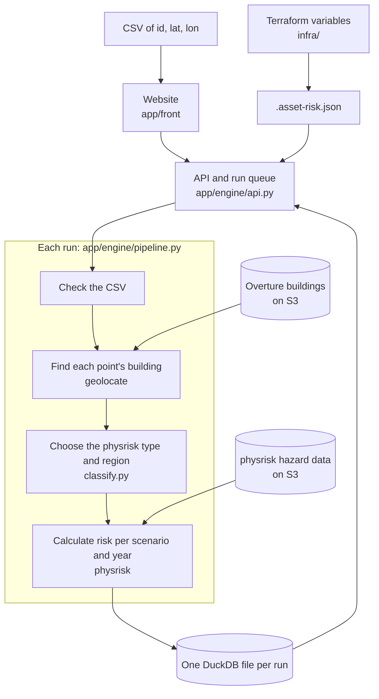
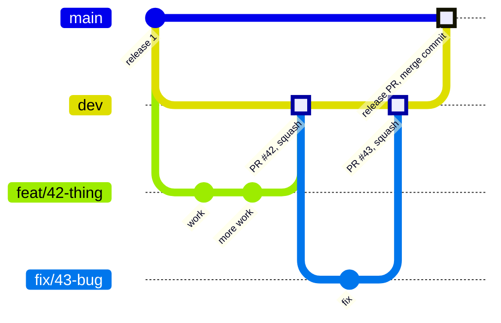

# asset-risk

Upload a CSV of `id, lat, lon` and get a physical climate risk view of the portfolio. Each point is
matched to a building with [geolocate](https://github.com/mnovovil/geolocate), assessed with
[physrisk](https://github.com/os-climate/physrisk), and shown in a web dashboard.

This is a screening tool, not a site-level assessment. Results are a share of asset value, and
[most buildings have no known type](docs/methodology.md#building-type), so read
[the methodology](docs/methodology.md) before relying on a number.


*A real run of the [demo portfolio](docs/assets/demo_portfolio.csv), 500 properties in the USA and
Spain, with the stages sped up. New Orleans is opened because it has some of the portfolio's
highest flood and wind losses: scoring below it doesn't make an asset low risk. The asset shown,
`US-312`, is by the French Quarter. The panel shows its river flood depth by return period, then
physrisk's 1-in-1000-year river and coastal flood maps, zoomed out to all of southern Louisiana:
they are the only hazard maps physrisk publishes. Its figures are screening estimates for
illustration. Map data © OpenStreetMap contributors, via OpenFreeMap and OpenMapTiles. Flood maps
from WRI Aqueduct Floods, via physrisk.*

## Quick start

You need Docker, [Terraform](https://developer.hashicorp.com/terraform/install) ≥ 1.3 or OpenTofu,
several GB of free disk for the first build, and internet access.

```bash
git clone --recurse-submodules git@github.com:mnovovil/asset-risk.git && cd asset-risk
terraform -chdir=infra init && terraform -chdir=infra apply   # writes the settings files
script/start.sh                                               # http://127.0.0.1:8000
```

Open the address and drop in a CSV. The page has a sample to download, and your file needs a header
with these columns:

```csv
id,lat,lon
empire-state,40.7484,-73.9857
big-ben,51.5007,-0.1246
```

The app has no login, so it only listens on localhost. Don't expose it as it stands.

## How it works



## Project layout

| Path | Contents |
|---|---|
| `app/engine` | Python computation and API |
| `app/front` | TypeScript website |
| `docker` | Image and compose stack |
| `docs` | [Reference](docs/reference.md), [methodology](docs/methodology.md), [data sources](docs/data-sources.md) and the physrisk demo notebook |
| `infra` | Terraform variables |
| `script` | Start script and ad-hoc tools |
| `test` | Tests |
| `vendor/geolocate` | geolocate, pinned as a submodule |

Settings, the API, performance and development commands are in the [reference](docs/reference.md).

## Branches and pull requests

All work goes through `dev`. `main` only receives releases from `dev`.



- Branch from `dev` and open the PR against `dev`. It's squash-merged.
- A release is a PR from `dev` to `main`, merged with a merge commit (never squashed, so the two
  branches keep sharing history).
- PRs into `main` from any other branch fail the `Source branch` check.
- Every PR needs green CI: `Source branch`, `Engine`, `Front end` and `Infra`.
- No direct pushes, force pushes or deletion on `dev` or `main`.

## License

[MIT](LICENSE). `vendor/geolocate`, physrisk and the data sources have their own terms.
